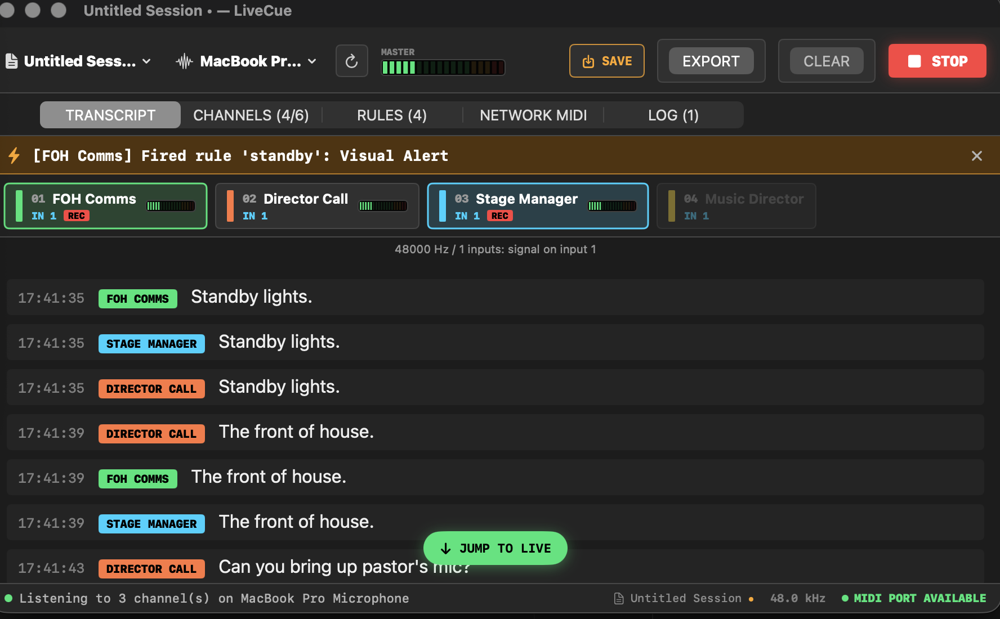
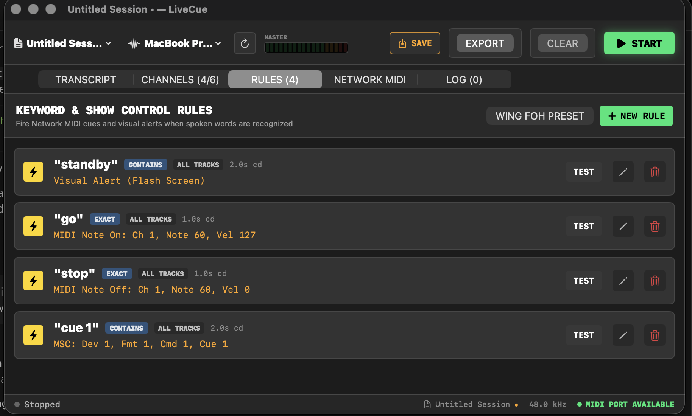
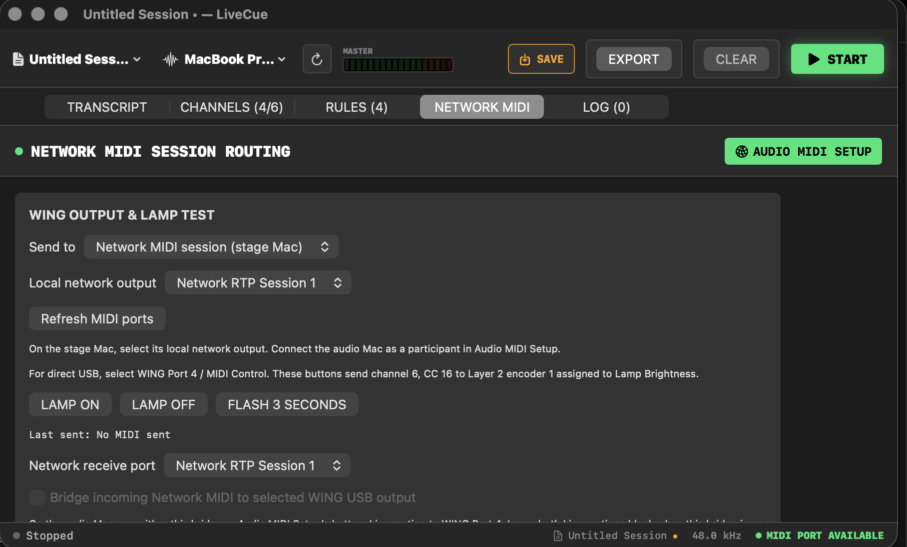

# LiveCue

**Say a word on comms, fire a cue.** LiveCue is a macOS app that transcribes
live talkback audio on the device and turns spoken keywords into MIDI show
control: QLab cues, MIDI Show Control for lighting desks, or console macros.

For anywhere a crew talks on comms: theatre, concerts, broadcast, conferences and
houses of worship.

It is an open-source take on what [ProdCom](https://prodcom.io) does, built on
Apple's new on-device `SpeechAnalyzer` / `SpeechTranscriber` APIs (macOS 26).
No audio leaves the machine and no internet connection is needed during a
show.



[**Download LiveCue**](../../releases/latest) · [How it works](#how-it-works) · [Status](#status)

---

## What it does

```
 comms mic ─► audio interface / Dante ─► LiveCue ─► transcript on screen
                                            │
                     "Front of House" ──────┴─► MIDI ─► QLab · Eos · grandMA · WING
```

- **Live transcript of up to 6 comms channels at once.** One CoreAudio tap
  feeds a separate speech transcriber per channel. The transcript is
  chat-style, with colored speaker badges and a level meter per channel.
- **Keyword rules → show control.** Contains, exact or prefix matching, an
  optional per-channel scope, and a per-rule cooldown so recognition jitter
  can't double-fire a cue. Matching is whole-word ("cue 1" never fires on
  "cue 10") and ignores punctuation the speech engine adds. Actions:
  - MIDI Note On/Off, Control Change, Program Change
  - **MIDI Show Control** (RP-002 SysEx: GO / STOP / RESUME / GO OFF with cue and list, FIRE with a macro number)
  - a visual alert that flashes the screen border
- **Network MIDI (RTP-MIDI)** through real CoreMIDI network endpoints, plus
  Bonjour discovery of `_apple-midi._udp` hosts, direct USB output, and an
  optional network-to-USB bridge.
- **Pro audio inputs**: any CoreAudio device, including Dante Virtual
  Soundcard, AVB and USB interfaces, with per-input channel mapping.
- **Test Connection and a Status window** (Connection menu, or TEST and
  STATUS in the top bar). Test Connection checks each hop to the console:
  this Mac's network session, the audio Mac on the network, the WING Lamp
  Bridge, the WING, and finally the lamp. It explains each problem in plain
  words. The Status window shows what's working right now. LiveCue checks
  the bridge every 10 seconds, and the status bar shows BRIDGE ONLINE.
- **Show files**: `.livecue` session documents with Save / Save As / Open
  Recent, holding transcript, channels, rules and the trigger log.
- **Export** the transcript as TXT, CSV or SRT subtitles.
- **Built for long shows**: audio queues are bounded, older transcript lines
  are archived to disk, and a regression test covers a 20,000-line session.

| Keyword rules | Network MIDI |
| --- | --- |
|  |  |

## How it works

```
┌──────────────────────────────────────────────┐
│ Audio device (interface, mic, Dante DVS)     │
└──────────────────────┬───────────────────────┘
                       │  one AVAudioEngine input tap
        ┌──────────────┼──────────────┐
  ChannelFeeder  ChannelFeeder  ChannelFeeder     pick one input, downmix, resample
        │              │              │
   Transcriber    Transcriber    Transcriber      SpeechAnalyzer + SpeechTranscriber
        └──────────────┼──────────────┘           (volatile partials + settled lines)
                       ▼
                     Model ─────────────► SwiftUI (transcript, meters, rules, log)
                       │
                KeywordMatcher               match mode, channel scope, cooldown
                       │
                   MIDIEngine                CoreMIDI: network, USB, MSC SysEx
```

| File | Role |
| --- | --- |
| [`AudioCapture.swift`](Sources/Talkback/AudioCapture.swift) | Multi-channel tap, per-channel feeders, bounded queues |
| [`Transcriber.swift`](Sources/Talkback/Transcriber.swift) | Wraps `SpeechAnalyzer` / `SpeechTranscriber` |
| [`KeywordMatcher.swift`](Sources/Talkback/KeywordMatcher.swift) | Rule matching and cooldowns |
| [`MIDIEngine.swift`](Sources/Talkback/MIDIEngine.swift), [`MIDIWire.swift`](Sources/Talkback/MIDIWire.swift) | Endpoint selection, MIDI 1.0 bytes, MSC, bridge |
| [`Model.swift`](Sources/Talkback/Model.swift) | Orchestrates capture, transcription, rules and sessions |
| [`TranscriptArchive.swift`](Sources/Talkback/TranscriptArchive.swift) | Moves older lines to disk in atomic batches |

It is Swift 6 with complete strict concurrency, Swift Package Manager, and
**no third-party dependencies**: only AVFoundation, Speech, CoreAudio,
CoreMIDI, Network and SwiftUI.

## Requirements

- macOS 26 (Tahoe) or later. The `SpeechTranscriber` API is new in macOS 26.
- Apple Silicon recommended.
- To build: Xcode 26 command-line tools (Swift 6).

## Build and run

```sh
swift build -Xswiftc -strict-concurrency=complete   # debug build
swift run LiveCue                                   # run it

./build.sh                                          # signed dist/LiveCue.app
open dist/LiveCue.app
```

Transcribe a file without any audio hardware:

```sh
swift run LiveCue --file speech.wav        # first channel
swift run LiveCue --file multitrack.wav 2  # channel 2
```

## Tests

```sh
sh scripts/test-memory.sh   # 20,000-line round trip, archive failure, audio overload, buffer ownership

# virtual CoreMIDI send/receive, endpoint renames, missing outputs
swiftc -parse-as-library -swift-version 6 -strict-concurrency=complete \
  Sources/Talkback/MIDIEngine.swift Sources/Talkback/MIDIWire.swift \
  scripts/NetworkMIDITest.swift -o /tmp/livecue-network-test && /tmp/livecue-network-test
```

None of these need a microphone or a speech-model download.

## Quickstart: fire a QLab cue by voice

1. On both Macs, open **Audio MIDI Setup → MIDI Studio → Network**, enable a
   session, and connect the other Mac as a participant.
2. In LiveCue's **Network MIDI** tab, pick that session as the network output.
3. In **Rules**, add a rule: keyword `go`, action **MIDI Note On**,
   channel 1, note 60, velocity 127. Press **Test** to fire it without
   speaking.
4. In QLab, give the cue a MIDI trigger of note 60 on channel 1.
5. Start transcription and say "go".

**Lighting desks (ETC Eos, grandMA)**: use a **MIDI Show Control** action,
for example device 1, `GO`, cue 101. LiveCue sends
`F0 7F 01 02 01 01 31 30 31 F7`.

**Behringer WING**: the **WING FOH PRESET** button in Rules adds a
"Front of House" rule that flashes the console lamp (channel 6, CC 16) for
three seconds. Console and receiving-Mac setup is in
[docs/TROUBLESHOOTING.md](docs/TROUBLESHOOTING.md) and
[`tools/WINGLampReceiver`](tools/WINGLampReceiver/README.md).

**WING Lamp Bridge** (separate install, for the Mac plugged into the WING):
a background version of that helper with no window. It starts at login and
forwards only the lamp control. It doesn't need LiveCue on that Mac.
[**Download WINGLampBridge.zip**](https://github.com/Shanetabr/LiveCue/releases/download/wing-lamp-bridge-v1.1.0/WINGLampBridge.zip),
then see [`tools/WINGLampBridge`](tools/WINGLampBridge/README.md) to install it.

## Status

LiveCue is a working prototype that has been tested on real show hardware.

**Verified on hardware**
- Network MIDI from the stage Mac reaches a second Mac and flashes a WING
  console lamp through a small CoreMIDI bridge
  ([findings](docs/dev-notes/NETWORK_MIDI_FINDINGS.md)).
- Direct USB to the WING from the stage Mac.
- The no-window WING Lamp Bridge on the console-side Mac: a network flash
  from the stage Mac lit the lamp (Nov 21).

**Not yet verified end to end**
- The spoken rule → network → console path in a single live run.
- Test Connection's bridge check over the real network. It needs WING Lamp
  Bridge 1.1 on the audio Mac and has only been tested with virtual MIDI ports.
- Dante Virtual Soundcard capture with more than two inputs.
- macOS's own Audio MIDI Setup "Live routing" didn't forward to the WING on
  a 2016 MacBook running Monterey. The bridge works around it.

**Known limits**
- English only (`en-US`).
- The built-in bridge forwards every message it receives. The standalone
  WING helper forwards only the lamp control.
- One send is capped at 256 bytes, so very large SysEx is rejected.
- Opening, saving or exporting a very long session loads its whole
  transcript into memory.

## Repository layout

```
Sources/Talkback/      the app (target: LiveCue)
Tests/                 memory and long-session checks
scripts/               test runners and hardware diagnostics
tools/WINGLampReceiver standalone macOS 11+ bridge for the console-side Mac
tools/WINGLampBridge   the same bridge with no window, starts at login (separate install)
docs/                  troubleshooting, MIDI/MSC protocol reference, ProdCom feature analysis
docs/dev-notes/        handoff and findings notes from development
plans/                 runbooks for upcoming hardware tests
```

## How it was built

LiveCue was built with AI coding agents, Claude among them. The handoff notes
the agents wrote between sessions, including the hardware debugging log, are
in [`docs/dev-notes`](docs/dev-notes/README.md).

## License

MIT. See [LICENSE](LICENSE).
